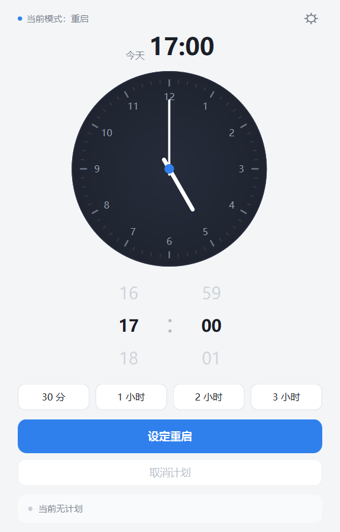
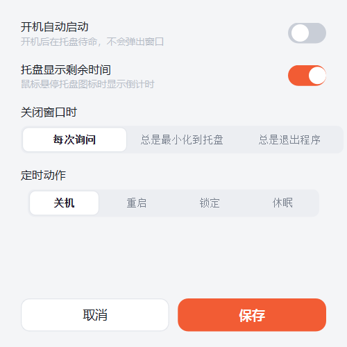

# 定时关机

Windows 桌面小工具：拖时钟选一个时刻，到点自动执行关机 / 重启 / 锁定 / 休眠。单文件 exe，无需安装，程序不联网。

<p align="center">
  
  &nbsp;
  
</p>

## 下载

到 [Releases](../../releases) 下载 `定时关机.exe`，双击即用，不需要管理员权限。

## 怎么用

- **拖时针**改小时，**拖分针**改分钟，或滚动下方的数字轮盘；也可以直接点表盘
- 点「设定关机」开始倒计时，点「取消计划」撤掉
- 点预设按钮 `30 分 / 1 小时 / 2 小时 / 3 小时` 一下搞定
- 右上角齿轮打开设置：切换定时动作（界面主题色跟着变）、开机自启、托盘显示、关窗行为

## 要知道的

- 关机 / 重启计划由 Windows 系统执行，关掉软件也生效；撤掉必须点「取消计划」或执行 `shutdown /a`
- 锁定 / 休眠计划靠本程序常驻执行，程序退出或电脑重启后失效
- 日志在 exe 同目录 `logs/app.log`；设置与计划记录存在 `%LOCALAPPDATA%\ShutdownScheduler`
- 卸载：删掉 exe 和 `logs` 文件夹即可（开过自启的话先在设置里关掉）

## 从源码构建

环境：Windows 10/11 + Python 3.13。

```bat
:: 安装依赖（虚拟环境内，国内用阿里云镜像）
python -m venv .venv
.venv\Scripts\python.exe -m pip install PyQt6 pyinstaller -i https://mirrors.aliyun.com/pypi/simple/

:: 开发期运行
.venv\Scripts\python.exe src\main.py

:: 打包单文件 exe，产物在 dist\定时关机.exe
scripts\build.bat
```

代码结构与设计约定见 `docs/`。
